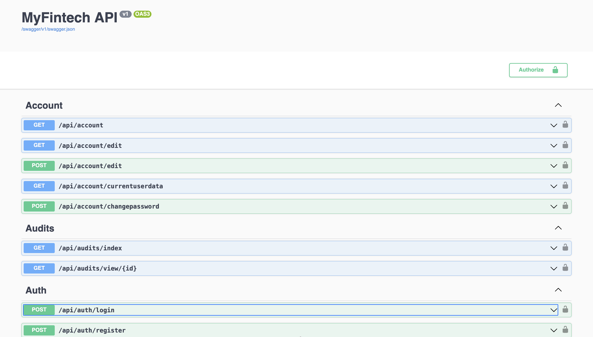

# MyFintech App Backend

 [](https://example.com) [](LICENSE)

 Clean, secure, and extensible .NET backend for MyFintech App — powering authentication, RBAC, customers, bank accounts, investments, file uploads, notifications, and audit trails etc.

 <div align="center">
	
  

</div>

 ## Highlights
 - Production-ready project structure with role-based access control (RBAC)
 - RESTful controllers for common fintech operations
 - EF Core for migrations & seeding
 - Ready for containerization and CI/CD

 ## Quick Start (local)
 1. Install .NET SDK (recommended: .NET 10) and ensure `dotnet --version` works.
 2. Copy configuration:

 ```bash
 cp appsettings_example.json appsettings.json
 # Edit appsettings.json to set your DB connection string and ports
 ```

 3. Restore, build and run:

 ```bash
 dotnet restore
 dotnet build
 dotnet run
 # or for live reload: dotnet watch run
 ```

 4. Open the API docs:

 ```
 http://localhost:8020/swagger
 ```

 ## Database
 - Create and apply EF migrations (EF tools required):

 ```bash
 dotnet tool install --global dotnet-ef # if not installed
 dotnet ef migrations add InitialCreate
 dotnet ef database update
 ```

 - Optional: run with seeding (project supports a seeder):

 ```bash
 dotnet run --seed
 ```

 ## Configuration notes
 - Use `appsettings_example.json` as a starting point. Sensitive values (secrets, SMTP, API keys) should be injected through environment variables or a secret store in production.


 ## Developer tips
 - Controllers live in `Controllers/` — add routes following existing patterns.
 - Entity models are in `Models/` and DB context is `Data/AppDBContext.cs`.
 - Use `Helpers/` for reusable utilities (email, hashing, RBAC helpers).

 ## Contributing
 - Fork the repo, create a feature branch, open a pull request. Keep changes focused and add tests for new behavior.

 ## License & Contact
 - Licensed under MIT.
 - Author: Tandoh Anthony Nwi Ackah — [GitHub](https://github.com/TandohAnthonyNwiAckah) — [anthony.tandoh@tanacom.io](mailto:anthony.tandoh@tanacom.io)

 Enjoy building — open an issue or PR if you need help.


